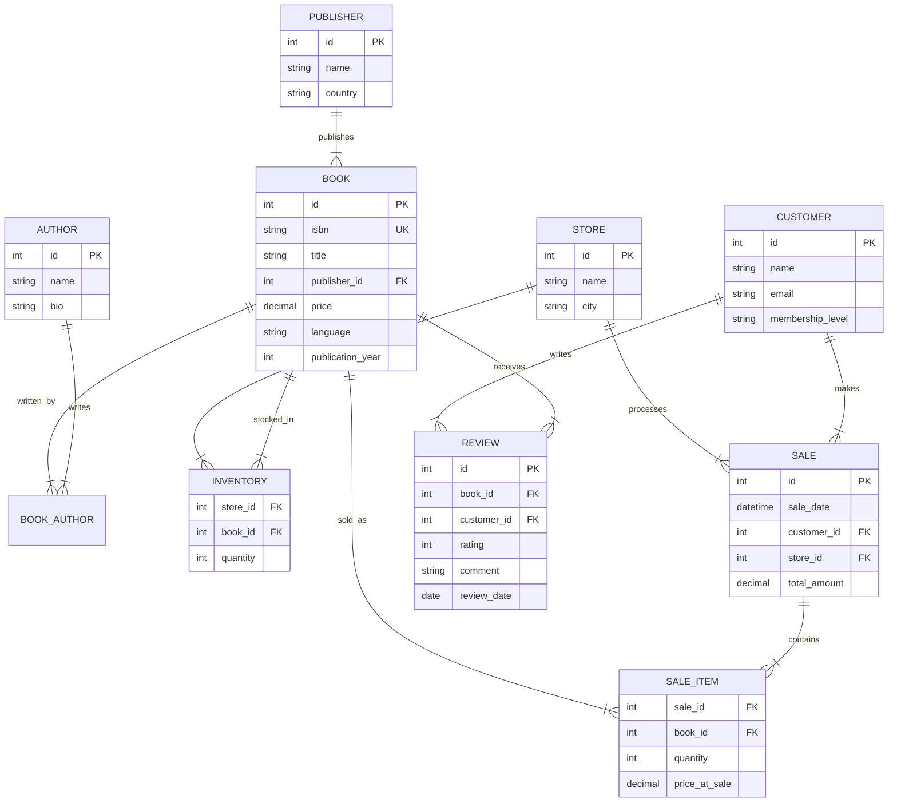

# University Book Store - Design Document

## 1. Overview
This project simulates a university book store system. It manages books, authors, publishers, inventory across multiple store locations, customer sales, and reviews.

## 2. Database Schema

### ER Diagram

### Table Definitions (Draft)

1.  **publishers**: `id`, `name`, `country`
2.  **authors**: `id`, `name`, `bio`
3.  **books**: `id`, `isbn`, `title`, `publisher_id`, `price`, `language`, `publication_year`
4.  **book_authors**: `book_id`, `author_id` (Many-to-Many)
5.  **stores**: `id`, `name`, `city`
6.  **inventory**: `store_id`, `book_id`, `quantity`
7.  **customers**: `id`, `name`, `email`, `membership_level` (Gold, Silver, Bronze)
8.  **sales**: `id`, `sale_date`, `customer_id`, `store_id`, `total_amount`
9.  **sale_items**: `sale_id`, `book_id`, `quantity`, `price_at_sale`
10. **reviews**: `id`, `book_id`, `customer_id`, `rating` (1-5), `comment`, `review_date`

## 3. SQL Scenarios (30 Cases)

### Basic Operations
1.  **List all books** published after 2020.
2.  **Find all authors** whose name starts with 'S'.
3.  **Get details of a specific book** by ISBN.
4.  **List all stores** in a specific city (e.g., "Mumbai").
5.  **Update inventory** for a book in a specific store.

### Joins & Relationships
6.  **List all books with their author names** (handling multiple authors).
7.  **Find all books published by** "Samskrita Bharati".
8.  **List books that are out of stock** in "Central Campus Store".
9.  **Get purchase history** for a specific customer.
10. **Find all customers who bought** "Meghadutam".

### Aggregates & Grouping
11. **Count total books** per publisher.
12. **Calculate total sales revenue** per store for the current month.
13. **Find the average price** of books in each language.
14. **Identify the top 5 customers** by total spending.
15. **Count the number of reviews** per rating (1-5 stars) for a specific book.

### Window Functions & Analytics
16. **Rank authors** by the number of books they have written.
17. **Calculate running total of sales** for each store over the last 30 days.
18. **Find the most expensive book** in each category/language (using `PARTITION BY`).
19. **Compare a book's price** to the average price of books by the same publisher.
20. **Identify "churned" customers** who haven't bought anything in the last 6 months but were active before.

### Complex Filtering & Subqueries
21. **Find books that have never been sold**.
22. **List customers who have bought every book** by a specific author (Division).
23. **Find books with a rating higher than the average rating** of all books.
24. **Get the list of authors who have also written reviews** (if we link authors to customers).
25. **Find stores where the inventory value** (price * quantity) exceeds $10,000.

### Views & Indexes
26. **Create a view `top_selling_books`** showing title, author, and total copies sold.
27. **Create a view `customer_activity`** summarizing total orders and last active date.
28. **Create an index on `books(isbn)`** for fast lookups.
29. **Create a composite index on `sales(store_id, sale_date)`** for reporting.
30. **Analyze query performance** for a complex join before and after indexing.

## 4. Implementation Plan

1.  **Setup Rust Project**: Initialize `university_bookstore` with `sqlx` and `tokio`.
2.  **Schema Migration**: Write SQL scripts to create tables.
3.  **Seed Data**: Generate realistic data (Sanskrit books, CS textbooks, fiction).
4.  **Implement Scenarios**: Write Rust functions to execute each of the 30 scenarios using `sqlx`.
5.  **Verify**: Run the Rust application to ensure all SQL works against SQLite.
6.  **Port to SSQL**:
    *   Declare all tables/columns in `SAMSQL/schema.सं`.
    *   Write `.सं` files for key scenarios (e.g., `top_selling_books.सं`, `customer_history.सं`).
    *   Compile and verify output matches the logic.
